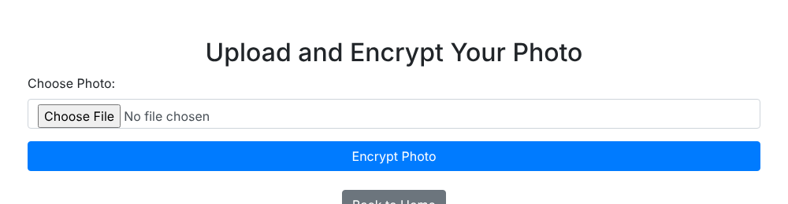
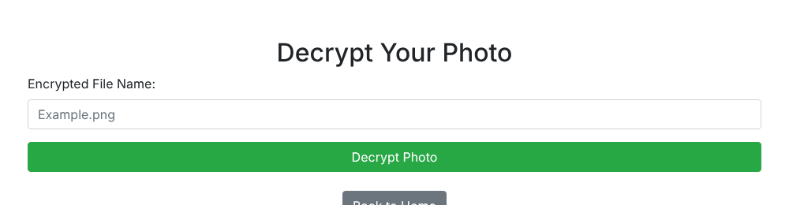

# Photo Encryption (Web App)

A Flask web app that encrypts uploaded photos and decrypts them in the browser. It was built with [Shatha](https://github.com/sha7cs).





## How it works

1. The user uploads a photo on the encrypt page.
2. The app encrypts the file with AES in CFB mode and a new random initialization vector.
3. The encrypted file is saved in `encrypted_photos`.
4. The user enters the file name on the decrypt page, and the app shows the decrypted photo.

## Setup

```bash
git clone https://github.com/JumanahAlmatrood/photo-encryption.git
cd photo-encryption
pip install -r requirements.txt
python main.py
```

Open `http://127.0.0.1:5000`.

## Limitations

This is a learning project and should not be used for real private photos.

- The AES key is fixed in `main.py`.
- The app has no user accounts, so anyone with access can decrypt any file.
- Original photos stay in `uploaded_photos` after encryption.

## Tools

Python, Flask, cryptography, Bootstrap

## Related project

[photos-encryption](https://github.com/JumanahAlmatrood/photos-encryption) is a desktop version of this idea.
